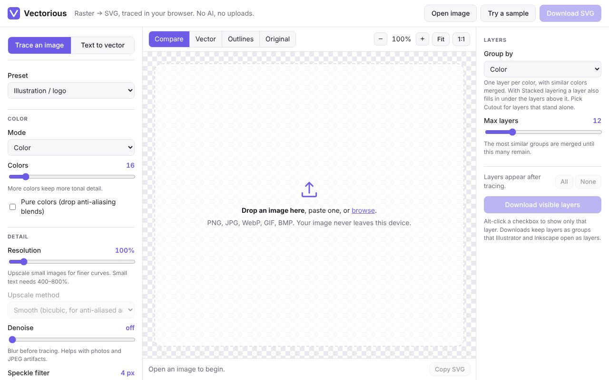

# Vectorious

<!-- site-summary:start -->
<!-- This section is this project's card on https://mendus59.github.io and is copied there daily.
     Keep it true of what's on main: one plain-text summary line (max 160 characters), then 1-6 short bullets.
     See CLAUDE.md ("Site summary"). -->
Convert raster images (PNG, JPG, WebP, GIF, BMP) or typed text into detailed SVG vector graphics, entirely in the browser.

- Traces each color layer with a built-in Potrace implementation into smooth Bezier curves, with no AI and nothing uploaded.
- Presets for photos, logos, small text and icons, line art and pixel art, with up to 128 colors.
- Traces tiny, low-resolution text cleanly by upscaling it, dropping anti-aliasing blends and refining edges against the original pixels.
- Turns typed text into vector outlines in 26 bundled fonts or your own, and finds the closest font to an image of text.
- Builds a new font (.otf) from the lettering in an image, so custom lettering can be typed in its own style.
- Splits the result into layers by color, shape, size or similar objects, and downloads any layer as an SVG.
<!-- site-summary:end -->

<!-- site-screenshot: docs/screenshot.jpg -->


Convert raster images (PNG, JPG, WebP, GIF, BMP) into detailed SVG vector graphics, entirely in the browser.

- **No AI.** Conversion uses classic, deterministic algorithms only.
- **Nothing is uploaded.** Images are processed locally in a Web Worker.
- **Static site.** Plain HTML/CSS/JS, no build step, hosted on GitHub Pages.

## How it works

1. **Upscale** (optional): small images are enlarged before tracing, with a bicubic (Catmull-Rom) filter for anti-aliased art, Scale2x for pixel art, or nearest neighbour. Potrace puts edges on pixel boundaries, so strokes one or two pixels wide only keep their shape once they are a few pixels wide.
2. **Denoise** (optional): a three-pass box blur that approximates a Gaussian.
3. **Color quantization**: k-means++ clustering in the OKLab perceptual color space. Images that already have few colors (logos, pixel art) keep their exact palette. With *Pure colors*, each cluster takes the most common exact color of the original instead of the cluster mean, and colors that lie on the line between two more common colors (anti-aliasing blends) are dropped: their pixels go to the nearer end, so edges land at 50% coverage where the artwork had them.
4. **Speckle filter**: connected regions smaller than N pixels merge into the neighbouring color they share the most border with.
5. **Tracing**: each color layer is traced with an implementation of the [Potrace](https://potrace.sourceforge.net/potrace.pdf) algorithm (Selinger, 2003). It decomposes the bitmap into boundary paths, finds the optimal polygon, adjusts vertices to sub-pixel accuracy, detects corners, fits Bézier curves, and optionally merges segments.
6. **Layering**: layers are stacked dark to light, so each layer is a brightness iso-level and adjacent shapes never leave hairline gaps. A "cutout" mode outputs non-overlapping shapes for cutting machines.

## Settings

| Setting | What it does |
| --- | --- |
| Preset | Starting points: Maximum detail, Photo, Illustration / logo, Small text / icon, Line art, Pixel art (exact or smoothed) |
| Mode | Color, Grayscale, or Black & white with a threshold slider |
| Colors | Palette size (2–128) |
| Pure colors | Use exact source colors and drop anti-aliasing blends (small text, icons, logos) |
| Auto threshold | Black & white: cut halfway between the ink and background peaks (Otsu's method finds the two) |
| Resolution | Upscales before tracing for finer curves (up to 800%) |
| Upscale method | Smooth (bicubic), Pixel art (Scale2x), or Hard pixels (nearest neighbour) |
| Denoise | Blur radius applied before quantizing |
| Speckle filter | Minimum region size in pixels |
| Pixel-exact edges | Outputs exact pixel outlines with no curve fitting (pixel art) |
| Smoothness | Potrace `alphamax`: 0 = all corners, 1.33 = all curves |
| Simplify curves / tolerance | Potrace curve optimization |
| Refine edges | Two-color results: fit the outlines to the original pixels (see below) |
| Layering / Layer order | Stacked or cutout, and the stacking order |

### Small, low-resolution text

Text a few pixels tall (a 139×25 banner, say) has strokes only one or two pixels wide, mostly made of anti-aliased edge pixels. Traced at its own size, k-means gives each shade of edge its own layer, the speckle filter removes the thin pieces, and Potrace rounds what is left into blobs. The **Small text / icon** preset upscales 8× with a smooth filter, so the anti-aliasing turns into sub-pixel edge positions, and uses *Pure colors*, so the output has the exact ink and background colors and true stroke weights. The app suggests it when you open an image under 400 px.

Thresholding an upscaled image still puts each edge where the interpolated image crosses 50%, which rounds off thin strokes and small holes. **Refine edges** (on in that preset) then treats the outlines as a deformable curve: it renders them anti-aliased at the original resolution, compares the result with the original pixel by pixel, and moves each outline point along its normal to shrink the difference, with light smoothing to keep curves fair (inverse rendering; plain iterative optimisation, no learned model). On a 139×25 banner it raised the overlap with the original from 88% to 94%. It runs on results with exactly two colors and images up to 250,000 pixels.

## Text to vector

The **Text to vector** tab turns typed text into SVG outlines. Glyphs come straight from the font file (read with [opentype.js](https://opentype.js.org/) 1.3.4, MIT, vendored in `js/vendor/`), so the result is exact vector text rather than a trace.

- Pick one of 26 bundled fonts (sans, serif, script, handwriting, playful, pixel, blackletter), upload a TTF/OTF/WOFF file, or, in Chrome and Edge, use an installed font.
- Size, letter spacing, width, line height, alignment, synthetic small caps, fill and background color.
- **Fit this font to the image** places the text over an open image: it measures the ink (the background is the most common border color, the ink the most common color farthest from it), sizes the text to the ink, matches letter spacing to the width, centres it on the ink's centre of mass, and copies the colors.
- **Find the closest font** runs that fit for every font, regular and small caps, and ranks them by the overlap (intersection over union) of the text with the ink. It is template matching, not machine learning, so it only knows the fonts it has; upload the original font if you have it.
- **Make a font from this image** builds a new font from lettering no bundled font matches. It traces the image (with edge refinement), cuts it into letters left to right (shapes stacked over each other, like the dot of an i, join one letter; letters that touch are cut at their thinnest column, aimed by the width of another copy of the same letter), names them with the words you typed, and writes an OpenType font with opentype.js. Metrics come from the image: cap height and x-height, the baseline where most letters stop, side bearings from the median gap between letters, and the space from the gaps between words. Each letter's other case is scaled from it, and letters the image doesn't have can be borrowed from a bundled font, sized to match (as small capitals when the lettering uses small caps). The font is placed back over the image, kept in the font list on this device, and downloads as an .otf.
- The Compare view puts the original under the new text, and downloads work like any other result.

Bundled fonts (OFL or Apache licensed, from Google Fonts) are listed with their licenses in [fonts/README.md](fonts/README.md). They load only when used.

## Layers

The Layers panel splits the result into layers you can show, hide, and download one at a time (or download every visible layer together). Alt-click a layer's checkbox to show only that layer. Every SVG keeps its layers as `<g>` groups that Illustrator and Inkscape open as layers.

| Group by | How layers are made |
| --- | --- |
| Color | One layer per palette color. Similar colors (closest in OKLab) merge until at most *Max layers* remain. |
| Shape | Each shape is measured with classic descriptors (fill of its minimum bounding rectangle, convexity, fit to an ellipse with the same second moments, elongation, stroke thickness) and sorted into round, rectangular, pointed, thin, or complex. |
| Size | Large (≥ 10% of the image), medium (≥ 1%), small (≥ 0.1%), and fine details. |
| Similar objects | k-means over size, shape descriptors, hole count, and color puts look-alike shapes in the same layer, up to *Max layers*. |

Shape, size, and similar-object grouping trace each color region on its own (cutout), and each shape keeps its holes, so any layer stands alone.

The preview supports compare (split slider), vector-only, outline, and original views, with zoom (wheel or buttons) and pan (drag).

## Running locally

Any static file server works. Web Workers don't load from `file://`, so the app falls back to the main thread there.

```sh
python3 -m http.server 8000   # then open http://localhost:8000
npm test                      # engine and text tests (Node 18+)
```

Fonts are fetched from `fonts/`, so Text to vector also needs a server rather than `file://`.

## Deployment

`.github/workflows/pages.yml` runs the tests and publishes the site to GitHub Pages on every push to `main`.
One-time setup: **Settings → Pages → Build and deployment → Source: GitHub Actions**.
